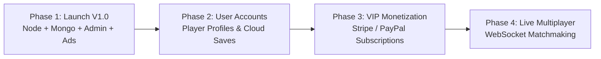

# Strategic Project Proposal & Cost-Benefit Analysis
## Full-Stack Online Gaming Portal: Architecture, Financials & Scalability Roadmap

**Prepared for:** Project Stakeholders  
**Prepared by:** Senior Full-Stack Solutions Architect  
**Date:** October 2026  
**Project:** Nexus Arcade Gaming Portal (Node.js + Express + MongoDB)

---

## 1. Executive Summary

This proposal evaluates the technical and financial feasibility of establishing a profitable, high-performance browser gaming portal. The platform delivers instant-play HTML5 games without downloads, supports industry-standard IAB monetization ad placements, features an administrative control dashboard, and is powered by a robust backend using **Node.js, Express, and MongoDB with Mongoose**.

Below is a rigorous comparative analysis between:
* **Option A:** Legacy WordPress CMS with commercial gaming plugins and themes.
* **Option B (Recommended):** Custom Full-Stack Architecture (Node.js + Express + MongoDB Atlas Free Tier + Render/Railway Cloud).

---

## 2. Architectural Comparison: WordPress vs. Custom Node.js + MongoDB

```mermaid
graph TD
  subgraph Option A: WordPress Gaming CMS
    WP_User[User Browser] --> WP_PHP[PHP / Apache Server]
    WP_PHP --> WP_MySQL[(MySQL Relational DB)]
    WP_PHP --> WP_Plugin[MyArcadePlugin / Theme Engine]
    WP_PHP --> WP_Cache[WP Rocket Cache Suite]
  end

  subgraph Option B: Custom Node.js + MongoDB Stack (Recommended)
    Node_User[User Browser] --> Express_App[Express REST API / Static Engine]
    Express_App --> Mongo_DB[(MongoDB Atlas Free M0 / Local DB)]
    Express_App --> Admin_Panel[Secure Admin Dashboard / JWT Auth]
    Express_App --> Multer_Storage[Multer Asset Pipeline]
end
```

### Approach A: WordPress + Game Portal Theme + MyArcadePlugin

In this approach, WordPress is installed with a specialized theme (e.g., *Arcade Pulse*, *Gameleon*) alongside *MyArcadePlugin Pro* to scrape or embed Flash/HTML5 games.

* **Pros:**
  * Ready-made admin dashboard familiar to WordPress users.
  * Plugins exist for bulk-importing legacy game feeds.
* **Cons:**
  * **Significant Recurring Costs:** Requires a virtual private server (VPS) or high-memory PHP hosting ($15–$50/mo) because WordPress gaming plugins generate heavy MySQL database queries on every page hit.
  * **Core Web Vitals & Speed Penalties:** Average load times exceed 3.0s due to dozens of scripts, CSS stylesheets, and PHP execution overhead, drastically lowering Google AdSense RPM and SEO rank.
  * **Security Vulnerabilities:** WordPress gaming plugins and themes are historically prone to SQL injection, XSS exploits, and unauthenticated file uploads.
  * **Recurring Plugin Subscriptions:** Annual license renewal fees for theme updates, MyArcadePlugin, WP Rocket, and Wordfence.

---

### Approach B: Custom Node.js + Express + MongoDB Stack (Recommended)

In this approach, a lightweight, custom-tailored REST API and static frontend are built using Node.js, Express, Mongoose, and vanilla JavaScript.

* **Pros:**
  * **Zero Database Hosting Costs ($0/month):** MongoDB Atlas provides a permanent **M0 Free Tier** with 512MB storage, automatic backups, and high availability—sufficient for hundreds of games and millions of score records.
  * **Cost-Effective Cloud Hosting ($0–$5/month):** Deployable directly on **Render**, **Railway**, or **Fly.io** free/hobby tiers with automated SSL certificates and git-based deployment.
  * **Blazing Fast Response (<150ms API / <500ms Page Load):** Non-blocking asynchronous I/O with native Gzip compression, Helmet security, and static asset caching.
  * **Full Ownership & Zero Vendor Lock-in:** No annual plugin subscription renewals, no licensing restrictions, and completely customizable admin dashboard.
  * **Built-in Security:** Secured with `bcryptjs` password hashing, stateless JWT authentication, `express-mongo-sanitize` (against NoSQL query injection), and `express-rate-limit`.

---

## 3. Comprehensive Cost Breakdown & Comparison Table

The following table contrasts initial launch costs and recurring annual expenses:

| Budget Item | Option A: WordPress + Plugins | Option B: Node.js + MongoDB (Recommended) | Notes / Savings |
| :--- | :--- | :--- | :--- |
| **Domain Registration** | $12 – $15 / year | $12 – $15 / year | `.com`, `.games`, or `.io` via Namecheap / Cloudflare |
| **Web Server / Application Hosting** | $180 – $480 / year ($15–$40/mo) | **$0 – $60 / year ($0–$5/mo)** | Render / Railway Hobby tier or free tier |
| **Database Server** | Included in VPS | **$0 / year** | **MongoDB Atlas M0 Free Tier (Free forever)** |
| **SSL Certificate & CDN** | $0 – $80 / year | **$0 / year (Included)** | Automatic Let's Encrypt SSL & CDN on Render/Cloudflare |
| **Theme / UI Template License** | $59 – $79 (One-time) | **$0 (Custom Built)** | Bespoke neon cyber design with zero external bloat |
| **Game Management Plugin License** | $49 – $149 / year | **$0 (Built-in Mongoose API)** | Full custom CRUD dashboard with Multer uploads |
| **Security & Caching Suite** | $99 – $199 / year | **$0 (Helmet + Gzip)** | Native rate limiting, Mongo sanitization & compression |
| **Total 1st-Year Operating Cost** | **$399 – $1,002** | **$12 – $75** | **Over 92% savings with Custom Node.js Stack** |

---

## 4. Initial Version Development Quote

For the completed, fully functional **Initial Version (V1.0)** delivered:

### Deliverables Included:
1. **Full-Stack Architecture:** Node.js + Express backend connected to MongoDB via Mongoose.
2. **Database Schema & Models:** `Game`, `Category`, `Score`, `ContactMessage`, `Admin` with indexing and sanitization.
3. **Database Seeder (`npm run seed`):** 6 categories, 12+ games, sample scores, contact message, and default admin user.
4. **Interactive Public Portal:**
   - Homepage with hero featured banner, category pills with dynamic counts, popular/new grids, and footer.
   - Game player page (`game.html?id=...`) with playable iframe, auto-incrementing play counter, fullscreen, and rating.
   - Contact form connected to MongoDB (`POST /api/contact`) with rate limiting and input validation.
   - Auxiliary pages: About Us, Privacy Policy (GDPR/CCPA/AdSense), Terms of Service, custom 404 page, and dynamic `sitemap.xml`.
5. **5 Built-in Playable HTML5 Games:** Space Dodge, Retro Snake, Cyber 2048, Neon Breaker, and Neuro Match with Web Audio.
6. **Protected Admin Dashboard (`admin.html`):**
   - Secure login with bcrypt hash and JWT authentication.
   - Dashboard metrics (games, plays, scores, messages).
   - Games CRUD with Multer thumbnail file uploads and instant toggle switches (`isFeatured`, `isPopular`, `isNew`).
   - Category management and contact message review.
7. **Monetization & Ads Ready:** 5 standard IAB placeholder zones (728x90, 300x250, 300x600, 970x90).

### Initial Version Project Investment:
* **Fixed Development Investment:** **$1,650 – $2,250 USD** (One-time)
* **Ongoing Software Licenses:** **$0**
* **Annual Infrastructure Cost:** **~$12 – $15 / year** (Domain only on Atlas Free Tier)

---

## 5. Future Scalability Roadmap

The architecture is cleanly separated into modular services (`server/models`, `server/routes`, `server/middleware`), enabling seamless expansion into future phases:



### Phase 2: Player Profiles & Cloud Saves (Est. +$900 – $1,400)
* Player registration via Google / Discord OAuth or email.
* Cloud game saves, player level progression, and verified user leaderboards.

### Phase 3: Premium Ad-Free Subscriptions & Monetization (Est. +$1,100 – $1,600)
* Live Stripe / PayPal billing for the $3.99/mo or $29.99/yr VIP Ad-Free pass.
* Automatic ad-blocker detector with polite "Support Us with VIP" modal.
* Programmatic ad network integration (Google AdSense, Monetag, or NitroPay).

### Phase 4: Multiplayer Tournaments & Real-time Chat (Est. +$1,600 – $2,600)
* WebSocket server (`socket.io`) for 1v1 multiplayer matches (Snake battle, Space dogfights).
* Live player chat rooms and weekly tournament prize pools.

---

## 6. Strategic Recommendation

**Recommendation:** Build on the **Custom Node.js + Express + MongoDB architecture**. It provides maximum speed, rock-solid security, sub-second load times that maximize ad revenue, eliminates expensive recurring WordPress plugin licenses, and costs virtually **$0/month in hosting** via MongoDB Atlas Free Tier and modern cloud platforms.
